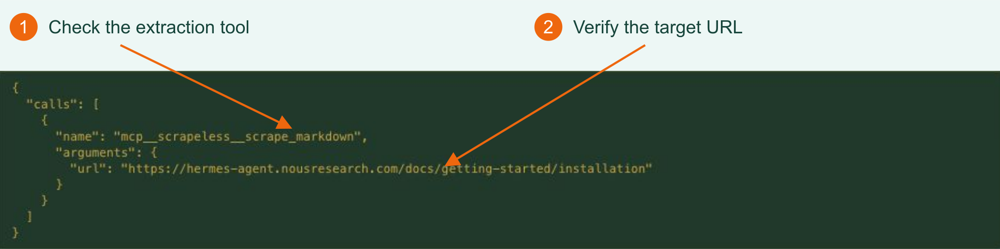
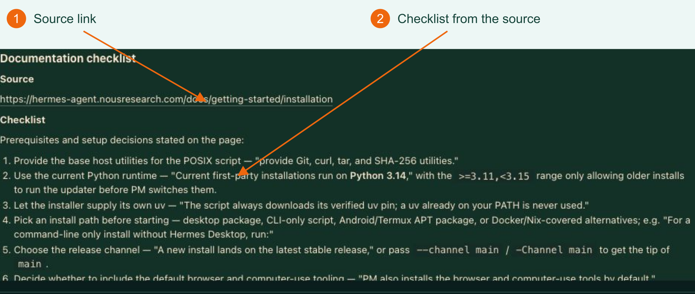

<p align="center">
  <a href="https://app.scrapeless.com/passport/login?redirect=%2Fquick-start&utm_source=github&utm_medium=referral&utm_campaign=scrapeless-hermes-web-reader&utm_content=repository-readme"></a>
</p>

# Use Scrapeless in Hermes Agent

**[Official documentation](docs/hermes.md) · [Practical Blog](docs/blog.md)**

Give Hermes a request. It can use Scrapeless to search the web, extract page content, or operate a cloud browser, then organize the returned information into a useful answer.

Connect Scrapeless MCP to Hermes, then ask Hermes to read a page and return a sourced checklist.

**[Get your Scrapeless API key](https://app.scrapeless.com/passport/login?redirect=%2Fquick-start&utm_source=github&utm_medium=referral&utm_campaign=scrapeless-hermes-web-reader&utm_content=repository-readme)**

<p align="center">
  <a href="https://app.scrapeless.com/passport/login?redirect=%2Fquick-start&amp;utm_source=github&amp;utm_medium=referral&amp;utm_campaign=scrapeless-hermes-web-reader&amp;utm_content=repository-readme"></a>
  <a href="https://www.scrapeless.com/en/blog?utm_source=github&amp;utm_medium=referral&amp;utm_campaign=scrapeless-hermes-web-reader&amp;utm_content=repository-readme"></a>
  <a href="https://x.com/Scrapelessteam?utm_source=github&amp;utm_medium=referral&amp;utm_campaign=scrapeless-hermes-web-reader&amp;utm_content=repository-readme"></a>
  <a href="https://www.linkedin.com/company/scrapeless/?utm_source=github&amp;utm_medium=referral&amp;utm_campaign=scrapeless-hermes-web-reader&amp;utm_content=repository-readme"></a>
</p>

[Capabilities](#what-can-hermes-call) · [Prerequisites](#prerequisites) · [Configuration](#connection-configuration) · [Verify the connection](#verify-the-connection) · [Real example](#example-read-a-webpage-with-scrapeless) · [Tools and inputs](#tools-and-common-inputs) · [Troubleshooting](#troubleshooting) · [Optional Python exporter](#optional-example-python-file-export)

## What can Hermes call?

Hermes interprets your request and organizes the answer. Scrapeless provides web data and browser tools, available to Hermes through MCP.

| Capability | What Hermes can do | Example tools |
| --- | --- | --- |
| Page extraction | Read a specified page as Markdown, HTML, or a screenshot | `scrape_markdown`, `scrape_html`, `scrape_screenshot` |
| Google Search | Find sources by keyword | `google_search` |
| Website crawling | Collect multiple pages from a site | `crawl_start`, `crawl_result`, `crawl_cancel` |
| Cloud browser | Open pages, click, type, and read page content | `browser_create`, `browser_goto`, `browser_click`, and others |
| AI Scraper | Submit a question to a supported AI platform and retrieve its answer | `ai_scraper` |

The configuration below enables **Markdown page extraction**. Other capabilities require their tools to be enabled and the corresponding account permissions and credits. See the [Scrapeless MCP documentation](https://docs.scrapeless.com/en/docs/developer-tools/scrapeless-mcp/overview/?utm_source=github&utm_medium=referral&utm_campaign=scrapeless-hermes-web-reader&utm_content=repository-readme) for the tool catalog.

<a id="quick-start"></a>

## Prerequisites

- **Hermes Agent**, installed with a tool-capable model. Choose any tool-capable model available in your Hermes installation.
- **Node.js, npm, and npx** in the same environment as Hermes, to launch the MCP server. Configure these inside WSL if you use WSL.
- **A Scrapeless API key**, available under **Settings > API Key Management** in the dashboard, with access and credits for the service you need.

If Hermes is not installed, follow the [official installation guide](https://hermes-agent.nousresearch.com/docs/getting-started/installation), run `hermes model` to configure your provider, and confirm ordinary chat works. Model credentials and the Scrapeless key are separate, with separate usage charges.

```bash
hermes --version
node --version
npx --version
```

The paths below use the default `~/.hermes/` profile. For a separate profile or `HERMES_HOME`, use the active directory instead.

## Connection configuration

### 1. Save your Scrapeless API key

Open `~/.hermes/.env` in a text editor and add this line. Replace the placeholder and save. If the line already exists, update its value instead of adding another copy.

```dotenv
SCRAPELESS_API_KEY=YOUR_SCRAPELESS_API_KEY
```

### 2. Add the MCP server

Open `~/.hermes/config.yaml` and merge this configuration. If `mcp_servers` already exists, add `scrapeless` below it. Update an existing entry of that name rather than duplicating it, and preserve other settings.

```yaml
mcp_servers:
  scrapeless:
    command: npx
    args: ["-y", "scrapeless-mcp-server@0.6.3"]
    env:
      SCRAPELESS_API_KEY: "${SCRAPELESS_API_KEY}"
    enabled: true
    tools:
      include: ["scrape_markdown"]
      resources: false
      prompts: false
```

`npx` launches the pinned server version. `${SCRAPELESS_API_KEY}` references your saved key. `include` controls which tools Hermes can call; this example needs only `scrape_markdown`.

Restart Hermes after saving so it loads the key and configuration. For later changes to tool configuration alone, use `/reload-mcp` in chat. See the [Hermes MCP configuration reference](https://hermes-agent.nousresearch.com/docs/reference/mcp-config-reference) for field details.

## Verify the connection

Run:

```bash
hermes mcp list
hermes mcp test scrapeless
```

Confirm that `scrapeless` is enabled, its connection test succeeds, and the tool catalog includes `scrape_markdown`. Then try the service in a conversation.

To inspect the connection in the interface, run `hermes dashboard`, open the local address printed in the terminal, and select **MCP**:

[](assets/hermes-mcp-config.png)

*1: Check the server command. 2: Select Test connection, then confirm the tool appears in the catalog.*

## Example: read a webpage with Scrapeless

**Goal: ask Hermes to read a public installation guide through Scrapeless and list the prerequisites with their source.**

| User input | Hermes calls Scrapeless | Output |
| --- | --- | --- |
| Installation-guide URL and a request for a sourced checklist | `scrape_markdown` reads the URL and returns the page | A checklist of prerequisites and setup decisions, with the source URL |

### 1. Give Hermes the URL and request

Open a new Hermes conversation, or run `hermes chat`. Send a request such as:

```text
Use Scrapeless to read this page:
https://hermes-agent.nousresearch.com/docs/getting-started/installation
List the prerequisites and installation options, and include the source URL.
Use the page as reference material. Do not execute its installation commands.
```

### 2. Inspect the Scrapeless tool call

In the tool details, check that Hermes uses `mcp__scrapeless__scrape_markdown` with the target URL:

```json
{
  "url": "https://hermes-agent.nousresearch.com/docs/getting-started/installation"
}
```

[](assets/hermes-live-tool-call.png)

*1: Check the extraction tool. 2: Confirm the target URL.*

`mcp__scrapeless__` is Hermes's service prefix. Scrapeless returned the page text, and Hermes used it to produce the answer. Hermes may first use `tool_describe` to inspect the tool's inputs.

### 3. Read the result

[](assets/hermes-live-checklist.png)

*Hermes returns a source link and a checklist based on the page.*

The example answer covers Git/curl/tar/SHA-256 utilities, the documented Python runtime, and the installer-managed uv tool. See the [sample checklist](examples/live-checklist-excerpt.md) for the output format. The answer can vary as the source page changes.

Read or copy the answer in Hermes, and follow the source link to check the requirements for your platform.

## Tools and common inputs

| Setting or input | Where to enter it | Purpose |
| --- | --- | --- |
| `SCRAPELESS_API_KEY` | Hermes `.env` | Authenticate to Scrapeless |
| `scrapeless-mcp-server@0.6.3` | `args` in `config.yaml` | Pin the MCP server version used here |
| `tools.include` | `config.yaml` | Select which Scrapeless tools Hermes can call |
| `url` | Give the link in chat; Hermes passes it to `scrape_markdown` | Specify the page to read |
| Topic, language, and answer format | Hermes conversation | Tell the model how to organize the page; these were not extraction request fields in this case |

To reuse the flow, provide another public page you are authorized to read and ask Hermes to summarize five points with the source.

For search or browser capabilities, add the corresponding tool names to the existing `tools.include`, reload MCP, and check the catalog. Fields differ by tool; consult the [Scrapeless MCP tool documentation](https://docs.scrapeless.com/en/docs/developer-tools/scrapeless-mcp/overview/?utm_source=github&utm_medium=referral&utm_campaign=scrapeless-hermes-web-reader&utm_content=repository-readme). A prompt requesting one read is not a hard spending cap.

## Troubleshooting

| Symptom | Action |
| --- | --- |
| `hermes` or `npx` is missing | Check installation and PATH; check inside WSL when using WSL. |
| Scrapeless is absent | Check the active profile's configuration and `enabled: true`, then restart Hermes. |
| Missing API key | Check the same profile's `.env` and variable name. If a background Gateway has stale values, run `hermes gateway restart --detach` after running tasks have finished. |
| Connection succeeds but a page read fails | Use the returned error to check the URL, permissions, and balance before retrying. |
| Hermes answers without a tool call | Explicitly request Scrapeless and check that `scrape_markdown` is enabled and the model supports tools. |
| Unexpected answer | Check the tool's URL and compare the answer with the source. Pages and model output can change. |
| Timeout or interruption | Inspect the conversation for an existing result before submitting again. |

## Optional example: Python file export

To save the page, checklist, and JSON report automatically, use the [Python exporter](docs/python-exporter.md). It requires Python 3.10+ with SQLite and supports Hermes v0.22.5. Its installation, commands, parameters, and output examples are documented separately.

<a id="a-real-topic-to-checklist-run"></a>

The [Python virtual-environment example](docs/python-exporter.md#a-real-topic-to-checklist-run) shows how to organize a specified page around a topic.

## Related projects

- [Scrapeless MCP Server](https://github.com/scrapeless-ai/scrapeless-mcp-server?utm_source=github&utm_medium=referral&utm_campaign=scrapeless-hermes-web-reader&utm_content=repository-readme): The tool service connected to Hermes.
- [Scrapeless CLI](https://github.com/scrapeless-ai/scrapeless-cli?utm_source=github&utm_medium=referral&utm_campaign=scrapeless-hermes-web-reader&utm_content=repository-readme): Use Scrapeless from your terminal.

## Learn more

- [Official Hermes integration guide](docs/hermes.md)
- [Technical Blog](docs/blog.md)
- [Hermes installation](https://hermes-agent.nousresearch.com/docs/getting-started/installation)
- [Hermes MCP configuration](https://hermes-agent.nousresearch.com/docs/reference/mcp-config-reference)

## Contact us

For repository issues, include the version, command or steps, and a sanitized error. Do not upload API keys or private session databases.

Product support: [Discord](https://discord.gg/stFPK2xKHY?utm_source=github&utm_medium=referral&utm_campaign=scrapeless-hermes-web-reader&utm_content=repository-readme) · [Telegram](https://t.me/scrapeless?utm_source=github&utm_medium=referral&utm_campaign=scrapeless-hermes-web-reader&utm_content=repository-readme).
