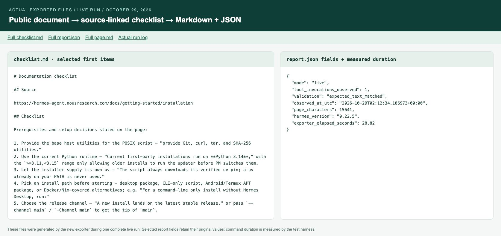
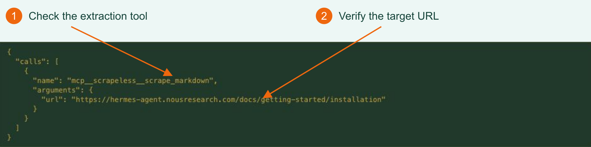
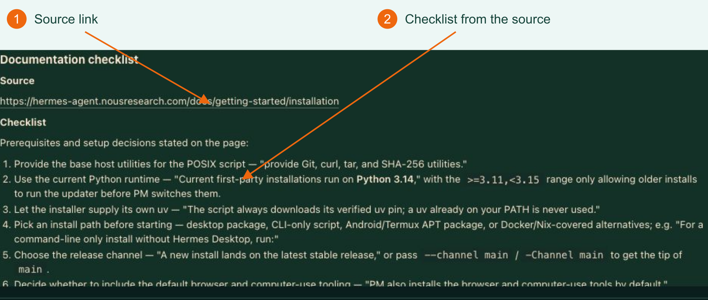

# Turn Web Documentation into a Sourced Checklist with Hermes and Scrapeless

**[Official documentation](hermes.md) · [Example Repo](../README.md) · [Practical Blog](blog.md)**

When reading an installation guide, you usually need to know what to prepare, which requirements apply to your platform, and what to do next. Those details may be spread across several sections, and copied excerpts can lose important conditions.

This example asks Hermes to read a specified document through Scrapeless MCP and produce a sourced checklist. It saves the original page alongside the answer so you can check the context later. Use it for installation guides, deployment instructions, or operating procedures.

## The input and the result

The input was the [official Hermes installation guide](https://hermes-agent.nousresearch.com/docs/getting-started/installation), with a request to list explicitly documented prerequisites and include the source URL.

The retained October 29 run saved **15,641 characters of source text, 15 numbered checklist items, and platform notes**. It took **28.82 seconds** end to end, with one observed extraction. This is one observation; page content, output, and duration can change.

[](../assets/live-output-files.png)

*Actual file viewer: selected checklist items on the left and report fields on the right, from the retained complete live run.*

Start by finding the requirements for your platform, then confirm their conditions in the saved source. Review any generated installation commands before deciding whether to execute them.

## 1. Prepare the project and connection

Follow the [Repo quick start](../README.md#quick-start) to download and enter the project directory. Prepare Python 3.10+, the supported **Hermes v0.22.5**, a configured model, and a Scrapeless API key.

The model organizes the material; Scrapeless reads the page. They incur separate usage. See the [integration guide](hermes.md#configure-mcp-in-hermes) for credentials and MCP configuration, and the Repo for pinned Hermes installation instructions.

Run the local preflight from the project directory:

```bash
python hermes_reader.py check
```

Continue once it passes. Preflight makes no model or extraction requests. Resolve version, tool configuration, or session database errors before proceeding.

## 2. Read the document and inspect the call

```bash
python hermes_reader.py run --output output/first-live
```

The default configuration already specifies the Hermes installation URL. The program passes the address and checklist request to Hermes, which calls Scrapeless and organizes the returned text. You do not need to write the full prompt separately.

In **Sessions > All > History**, open the completed task and expand `tool_call`:

[](../assets/hermes-live-tool-call.png)

*1: Check the extraction tool. 2: Confirm the URL. This is the retained October 29 run.*

Confirm the address matches the page you intended to read, then inspect the answer:

[](../assets/hermes-live-checklist.png)

*The beginning of the actual English answer from the same run, including the source and initial items. The full answer includes platform notes.*

## 3. Use the three saved files

Open `output/first-live/` after the run:

| File | When to read it |
| --- | --- |
| `checklist.md` | Start here for tools, environment requirements, and platform conditions. |
| `page.md` | Check the surrounding source when a requirement is unclear or may not apply to you. |
| `report.json` | Verify the source, run mode, extraction count, and validation result. |

The observed answer discusses the Python runtime Hermes uses, updater compatibility, desktop packages, and source builds. Keep those conditions separate rather than treating every installation option as mandatory.

The package includes a [real checklist excerpt](../examples/live-checklist-excerpt.md) and [real report](../examples/live-report.json). Text matching and call checks can detect wrong pages or unexpected tools; individual conclusions still need review against the source.

## 4. Use your own document

Change `url` in `config.json` and replace `expected_text` with phrases expected on the new page. This helps check that the returned text belongs to the intended page. Choose a new output directory:

```bash
python hermes_reader.py check
python hermes_reader.py run --config config.json --output output/another-document
```

For topic-specific organization, see the Repo's [Python virtual environment example](../README.md#a-real-topic-to-checklist-run). It shows the exact topic, specified official source, and returned commands to create, activate, and leave an environment.

If a run times out, check Hermes History before rerunning; the remote task may already have completed. The program does not retry automatically. Call counts are checked after execution and do not impose a hard spending cap.

Use the [official integration guide](hermes.md) for setup and the [Repo](../README.md) for complete commands, parameters, and troubleshooting.
