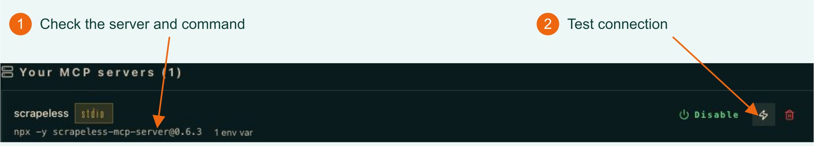

# Hermes Agent

**[Official documentation](hermes.md) · [Example Repo](../README.md) · [Practical Blog](blog.md)**

Connect Scrapeless MCP to Hermes Agent, verify the connection, and call the extraction tool in a conversation. For the runnable exporter and saved files, continue to the Repo and Blog.

## What is Hermes Agent?

Hermes Agent is an open-source AI agent developed by Nous Research. It can call tools, read source material, and organize results from natural-language tasks. It supports external services through MCP, making their capabilities available in a conversation.

## What can Hermes do after connecting?

After connecting Scrapeless MCP, you can perform the following tasks in Hermes:

| Capability | What you can do |
| --- | --- |
| Google Search | Retrieve keyword search results and set language and country or region. |
| Page extraction | Retrieve Markdown, HTML, or a screenshot from a URL. |
| Website crawling | Set page limits, path scope, and depth; crawl multiple pages and retrieve or cancel jobs. |
| Cloud browser | Manage sessions, navigate, go back and forward, click, type, press keys, wait, scroll, and retrieve page structure, text, HTML, and screenshots. |
| AI Scraper | Retrieve answers and any returned source data from ChatGPT, Gemini, Perplexity, Microsoft Copilot, Google AI Mode, Google AI Overview, Grok, and Amazon Alexa. |

Retained live evidence verifies Markdown extraction. The other rows describe available use cases; this guide does not demonstrate each capability.

This tutorial uses Stdio and pins `scrapeless-mcp-server@0.6.3`. The configuration below enables only `scrape_markdown` for the walkthrough. Service availability depends on your account permissions and credits.

## Configure MCP in Hermes

### 1. Prepare Hermes and your API key

Install Hermes from its [official installation guide](https://hermes-agent.nousresearch.com/docs/getting-started/installation). The CLI path on Linux/macOS/WSL2 is:
```bash
curl -fsSL https://hermes-agent.nousresearch.com/install.sh | bash
hermes --version
hermes model
hermes chat
```
After installation, reload your shell if necessary. Run `hermes model`, choose your provider, enter its credential in Hermes, and select a tool-capable model. Start one ordinary chat to confirm the model works and initialize the session database. Model credentials are separate from the Scrapeless API key. In the desktop interface, open **Models > Model Settings > Change**.


Ensure Node.js, npm and `npx` are available in the same environment as Hermes. If you use WSL, configure them inside WSL.

Check in your terminal:

```bash
hermes --version
node --version
npx --version
```

If `hermes` cannot be found, check the launcher location. If installed at `~/.local/bin/hermes`, use that full path in the commands below or add the directory to `PATH`.

Next, create an API key under **Settings > API Key Management** in the [Scrapeless Dashboard](https://app.scrapeless.com/?utm_source=website&utm_medium=referral&utm_campaign=scrapeless-hermes-web-reader&utm_content=article-body). Confirm that your account has the required permissions and credits. Actual service calls consume the corresponding credits.

Open `~/.hermes/.env` in a text editor. Start a new line at the bottom of the file and paste:

```dotenv
SCRAPELESS_API_KEY=YOUR_SCRAPELESS_API_KEY
```

Replace `YOUR_SCRAPELESS_API_KEY` with your actual key, keep the `SCRAPELESS_API_KEY=` prefix, and save the file. If the line already exists, update the key after the equals sign instead of adding a duplicate.

The configuration below uses the default profile's `~/.hermes/` directory. For another profile or a custom `HERMES_HOME`, use the active configuration directory.

### 2. Add Scrapeless MCP Server

Open `~/.hermes/config.yaml` and add the following configuration. If `mcp_servers` already exists, merge `scrapeless` into that section and preserve other server entries:

```yaml
mcp_servers:
  scrapeless:
    command: npx
    args: ["-y", "scrapeless-mcp-server@0.6.3"]
    env:
      SCRAPELESS_API_KEY: "${SCRAPELESS_API_KEY}"
    enabled: true
    tools:
      include: ["scrape_markdown"]
      resources: false
      prompts: false
```

`npx -y` downloads the pinned version when needed; no global installation is required. `${SCRAPELESS_API_KEY}` references the key you saved, and `include: ["scrape_markdown"]` exposes only the Markdown extraction tool to Hermes.

Save the file and restart Hermes to load the configuration and key. For later changes limited to MCP configuration, run `/reload-mcp` in the conversation.

If you use a background Gateway and the conversation still reports a missing key, run the following when no tasks are running, then start the conversation again:

```bash
hermes gateway restart --detach
```

### 3. Verify the MCP connection

Run in your terminal:

```bash
hermes mcp list
hermes mcp test scrapeless
```

Confirm that `scrapeless` is enabled, the connection succeeds, and the tool catalog includes `scrape_markdown`.

To inspect it in the interface, run the following command and open the local address printed in the terminal:

```bash
hermes dashboard
```

Open **MCP**, find `scrapeless`, and click **Test connection**:

[](../assets/hermes-mcp-config.png)

*1: Check the server command. 2: Click Test connection. This is the configured server card; use the command output to verify the extraction tool. Click to enlarge.*


## First call: read a webpage

After the connection test succeeds, start a conversation:

```bash
hermes chat
```

Send this prompt:

```text
Use Scrapeless to read this page:
https://hermes-agent.nousresearch.com/docs/getting-started/installation
Summarize the installation options in three sentences and include the source URL.
Treat the page as reference material; do not execute its commands. Report any extraction failure.
```

Expect a `mcp__scrapeless__scrape_markdown` tool call followed by an answer with a source link. The `scrapeless` part matches the server name in your configuration. Exact wording depends on the page and model.

This checks that the tool works in conversation. See the [Repo walkthrough](../README.md#a-real-topic-to-checklist-run) and [Blog](blog.md) for retained input, screenshots, and file export instructions.

## Troubleshooting

| Symptom | Action |
| --- | --- |
| `hermes` or `npx` is missing | Check installation and PATH. Run WSL setup and commands inside WSL. |
| Scrapeless is not listed | Check the active profile's `config.yaml` and `enabled: true`; restart or use `/reload-mcp`. |
| Missing API key | Check the same profile's `.env` and variable name, then restart Hermes. See the Gateway instructions above if applicable. |
| Connection works but extraction fails | Use the returned error to check the URL, service permissions, and credits before retrying. |
| Other tools are absent | This configuration exposes only `scrape_markdown`; add other tools when needed. |

## Continue using the tools in Hermes

Keep the MCP configuration to continue using Scrapeless in later Hermes conversations. Change the URL and output requirements to apply the same flow to documentation summaries, procedural checklists, or source reading.

For other web data tasks, explicitly enable the corresponding supported tool in your configuration, then use `google_search` to find sources, `crawl_start` to collect multiple pages, or browser tools to work with dynamic pages. To retrieve an AI platform's answer, use `ai_scraper` with the platform and prompt.

- [Scrapeless MCP documentation](https://docs.scrapeless.com/en/docs/developer-tools/scrapeless-mcp/overview/?utm_source=website&utm_medium=referral&utm_campaign=scrapeless-hermes-web-reader&utm_content=article-body)
- [Scrapeless MCP Server repository](https://github.com/scrapeless-ai/scrapeless-mcp-server?utm_source=website&utm_medium=referral&utm_campaign=scrapeless-hermes-web-reader&utm_content=article-body)
- [Hermes MCP configuration reference](https://hermes-agent.nousresearch.com/docs/reference/mcp-config-reference)
